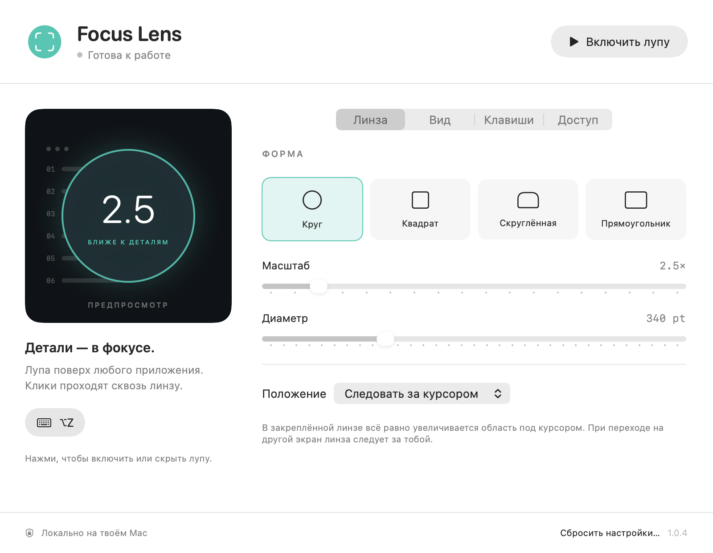

# Focus Lens

Экранная лупа для macOS: увеличивает область под курсором, пропускает клики
в приложение под ней и управляется одной рукой. Написана на Swift, SwiftUI
и AppKit, без сторонних библиотек.

Идея функциональности — экранное увеличение, как в Cursor Glass. Исходный код,
интерфейс и графика Focus Lens созданы самостоятельно.



## Установка

Сейчас приложение устанавливается сборкой из исходников на своём Mac.
Платная учётная запись Apple Developer не требуется.

### 1. Подготовить инструменты

Нужны **macOS 14+**, **Swift 6.2+**, Git, Python 3 и OpenSSL/LibreSSL.
Swift и Git входят в Xcode либо Command Line Tools. Если инструменты Apple
ещё не установлены, открой Terminal и выполни:

```sh
xcode-select --install
```

Дождись окончания установки и проверь доступность инструментов:

```sh
swift --version
git --version
python3 --version
openssl version
```

Если версия Swift ниже 6.2, обнови Xcode или Command Line Tools до совместимой версии.
Сборка проверена на Apple Silicon с macOS 26.2 и Swift 6.3.2. Скрипт собирает
приложение для архитектуры текущего Mac; запуск на Intel отдельно не проверялся.

### 2. Скачать и собрать

В Terminal выполни:

```sh
mkdir -p "$HOME/apps"
git clone https://github.com/Mat1ro/focus-lens.git "$HOME/apps/FocusLens"
cd "$HOME/apps/FocusLens"
bash scripts/build.sh ..
open '../Focus Lens.app'
```

В `~/apps/FocusLens` будут исходники, рядом — готовое `~/apps/Focus Lens.app`.
После первой сборки приложение открывается двойным щелчком в Finder;
Terminal для повседневного использования не нужен.

При первой сборке скрипт создаёт постоянный локальный сертификат и отдельную
связку ключей для подписи. Это помогает сохранять разрешение на экран при
последующих сборках. Настройки доверия системы не изменяются.

Если удобнее хранить приложение в «Программах», перенеси туда `.app` **перед
выдачей доступа к экрану** и запускай именно эту копию. При обновлениях заменяй
её новой сборкой, предварительно завершив приложение.

### 3. Разрешить доступ к экрану

1. В Focus Lens открой вкладку **«Доступ»** и нажми **«Проверить доступ»**.
2. Открой **Системные настройки → Конфиденциальность и безопасность → Запись
   экрана и системного звука**. В некоторых версиях macOS раздел называется
   просто «Запись экрана». Кнопка **«Настройки macOS»** ведёт в этот раздел.
3. Включи **Focus Lens**. Если записи нет, нажми **«+»** и выбери установленный
   `Focus Lens.app`. Кнопка **«Показать текущее приложение в Finder»** помогает
   найти нужную копию.
4. Если macOS предложит **«Завершить и открыть снова»**, согласись.
5. Вернись во вкладку «Доступ» и нажми **«Проверить доступ»**. Должна появиться
   надпись **«Доступ к экрану открыт»**.

Это системное разрешение нужно для получения изображения под курсором.
Focus Lens не записывает видео и звук. Подробнее о разрешении —
[в инструкции Apple](https://support.apple.com/en-gb/guide/mac-help/mchld6aa7d23/mac).

### 4. Включить лупу

Нажми **левый ⌥ Option + Z** или кнопку **«Включить лупу»**. Тем же сочетанием
лупа выключается. Наведи курсор на текст в другом приложении: он должен
увеличиться внутри линзы. Можно продолжать нажимать кнопки и печатать — линза
пропускает мышь и не забирает клавиатурный фокус.

## Настройка

Приложение находится **в строке меню**, под значком лупы, без отдельного значка
в Dock. Нажми этот значок → **«Настройки…»**. Открытие настроек скрывает линзу;
после настройки включи её снова. Закрытие окна не завершает приложение.

### Вкладка «Линза»

| Параметр | Что меняет |
|---|---|
| Форма | Круг, квадрат, скруглённый или обычный прямоугольник |
| Масштаб | Увеличение содержимого от 1,5× до 10× |
| Диаметр / ширина | Размер самой линзы от 160 до 800 pt |
| Высота | Для прямоугольных форм: от 120 до 600 pt |
| Положение | Следовать за курсором или стоять в одном из четырёх углов экрана |

В закреплённой линзе по-прежнему увеличивается область **под курсором**.
При перемещении курсора на другой экран линза переходит на него.
Для начала можно оставить круг, масштаб 2,5× и следование за курсором.

### Вкладка «Вид»

- **Затемнять фон** — приглушает экран вокруг линзы; интенсивность регулируется.
- **Обводка линзы** — включает рамку, её толщину и мягкое свечение.
- **Показывать указатель внутри** — включает стрелку внутри линзы и её размер.
- **Сглаживать увеличенные пиксели** — делает изображение мягче; выключи для
  просмотра отдельных пикселей.
- **Частота** — 30 fps для меньшей нагрузки или 60 fps для более плавного движения.

### Вкладка «Клавиши»

Стандартные сочетания собраны рядом с **левым Option**, чтобы работать одной рукой:

| Сочетание | Действие |
|---|---|
| **⌥Z** | Включить / выключить лупу |
| **⌥X** | Включить / выключить затемнение |
| **⌥A / ⌥S** | Уменьшить / увеличить масштаб |
| **⌥Q / ⌥W** | Уменьшить / увеличить размер линзы |
| **⌥C** | Следующая форма |
| **⌥V** | Закрепить сверху справа / следовать за курсором |

Буквы обозначают **физические клавиши английской раскладки**. Другие углы
закрепления выбираются во вкладке «Линза».

Чтобы назначить своё сочетание:

1. Нажми текущее сочетание справа от нужного действия.
2. Нажми новую комбинацию с **Control, Option или Command**.
3. Если она свободна, приложение сразу её сохранит. Если занята или дублирует
   другую команду Focus Lens, появится сообщение — выбери другую.
4. **Esc** отменяет переназначение.

Сочетания глобальные: они работают и в других приложениях. Если привычная
комбинация там перестала работать, переназначь её в Focus Lens.

Все настройки сохраняются автоматически. **«Сбросить настройки…»** возвращает
стандартные параметры линзы **и горячие клавиши** после подтверждения.
Полностью закрыть приложение можно через **«Завершить Focus Lens»** в строке меню.

## Если что-то не работает

### Доступ включён, а приложение его не видит

Такое возможно после смены подписи или при запуске другой копии приложения.
В настройках записи экрана удали старую запись Focus Lens через **«−»**, добавь
текущий `.app` через **«+»** и включи переключатель. Перезапусти Focus Lens,
если этого попросит macOS, затем нажми **«Проверить доступ»** в приложении.

### Focus Lens нет в списке разрешений

Добавь его кнопкой **«+»**. В окне выбора нажми **⇧⌘G**, введи `~/apps/`
и выбери `Focus Lens.app` — либо укажи папку, куда ты его перенёс.

### Горячая клавиша не срабатывает

Проверь, что приложение запущено: в строке меню должен быть значок лупы.
Открой «Клавиши» и посмотри, нет ли сообщения о занятом сочетании.
Назначь другую комбинацию или включи лупу из меню.

### macOS блокирует открытие приложения

У этой личной сборки нет нотарификации Apple. Если ты доверяешь исходникам
и собранному приложению, после попытки запуска можно открыть **Системные
настройки → Конфиденциальность и безопасность** и воспользоваться кнопкой
**«Всё равно открыть»**, если она доступна. См.
[инструкцию Apple](https://support.apple.com/en-gb/102445).

### Изображение чёрное или обновляется медленно

Проверь линзу над обычным текстовым окном: некоторые приложения не отдают
защищённое содержимое, например DRM-видео. Для снижения нагрузки выбери 30 fps
и уменьши размер линзы во вкладках «Вид» и «Линза».

## Обновление

Сначала выбери **«Завершить Focus Lens»** в строке меню. Если ты установил
приложение по инструкции выше и не менял исходники, выполни:

```sh
cd "$HOME/apps/FocusLens"
git pull --ff-only
bash scripts/build.sh ..
open '../Focus Lens.app'
```

Параметры и пользовательские клавиши сохраняются. При сохранённом локальном
сертификате разрешение на экран обычно сохраняется тоже.

Сертификат находится в `~/Library/Application Support/FocusLens/Signing`.
Не удаляй его между сборками и не публикуй связку ключей или её пароль.
`FOCUS_LENS_SIGNING_DIR` позволяет выбрать другое постоянное хранилище.

## Приватность

ScreenCaptureKit получает изображение выбранного экрана при включённой лупе
или кратковременно при нажатии «Проверить доступ». В памяти удерживается последний
кадр. Видео, звук и изображения рабочего стола не записываются на диск,
сетевых запросов нет. Микрофон и доступ Accessibility не запрашиваются.
macOS может показывать системный индикатор захвата во время работы.

Окна Focus Lens исключены из потока: линза и затемнение не захватывают сами себя.
Поэтому собственное окно настроек внутри линзы также не отображается.

## Для разработки

Проект можно открыть в Xcode через `Package.swift`.
`bash scripts/build.sh` без аргумента помещает приложение в `dist/`.
Первый аргумент меняет каталог результата, а `FOCUS_LENS_BUILD_DIR` — каталог
промежуточной сборки. В обычном использовании запускай `.app`, чтобы разрешение
на экран было привязано к приложению.

```sh
bash scripts/test.sh
```

Тесты проверяют геометрию линзы, границы экранов, преобразование Retina,
закрепление и нормализацию параметров. Полный отчёт — [VALIDATION.md](VALIDATION.md).

Отрисовка собственного окна и линз на искусственном изображении:

```sh
'../Focus Lens.app/Contents/MacOS/FocusLens' --render-preview /tmp/focus-lens-preview
```

Проверка исключения собственных окон через самостоятельный запуск `.app`:

```sh
open -n '../Focus Lens.app' --args --feedback-check /tmp/focus-lens-feedback.txt
```

Для второй проверки нужен доступ к экрану. Она ненадолго показывает цветные
тестовые панели и записывает текстовый отчёт; пиксели рабочего стола не сохраняются.

| Часть проекта | Назначение |
|---|---|
| `LensCore` | Геометрия, формы и параметры |
| `ScreenCapture` | ScreenCaptureKit, исключение окон и последний кадр |
| `Overlay` | Прозрачные панели, рисование линзы и затемнения |
| `AppModel` | Разрешения, жизненный цикл, смена экранов и команды |
| `HotKeys` | Глобальные клавиши и редактор сочетаний |
| `SettingsView` | Настройки SwiftUI |

## Ограничения

- Защищённое содержимое может быть недоступно для увеличения.
- Внутри линзы отображается обычная стрелка; текстовый курсор и специальные
  курсоры других приложений не воспроизводятся.
- У границ экрана недоступные пиксели дополняются тёмным фоном.
- 60 fps — целевая частота; фактическая плавность зависит от дисплея и нагрузки.
- Системные защищённые окна могут находиться выше линзы. Экран блокировки
  не поддерживается; при засыпании дисплеев линза выключается.
- Несколько физических мониторов, полноэкранные приложения и Spaces требуют
  дополнительной ручной проверки; подробности — в отчёте о проверке.

## История изменений

- **1.0.4** — сочетания из двух клавиш сгруппированы у левого Option.
- **1.0.2** — постоянный локальный сертификат и проверка доступа реальным кадром.
- **1.0.1** — исправлено рекурсивное попадание линзы в собственный захват.

Документация Apple для разработчиков:
[ScreenCaptureKit](https://developer.apple.com/documentation/screencapturekit/capturing-screen-content-in-macos).
